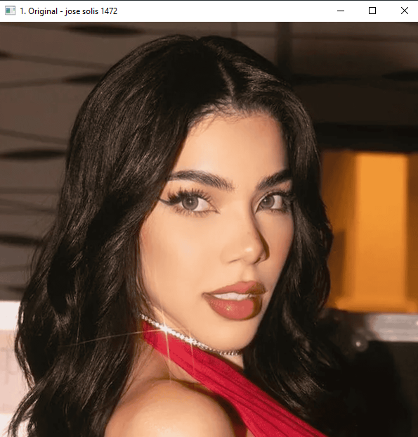
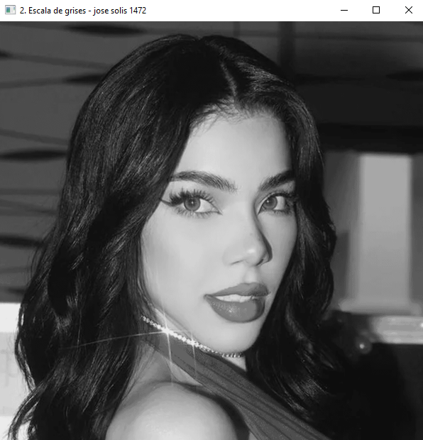
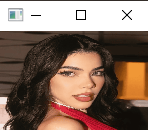
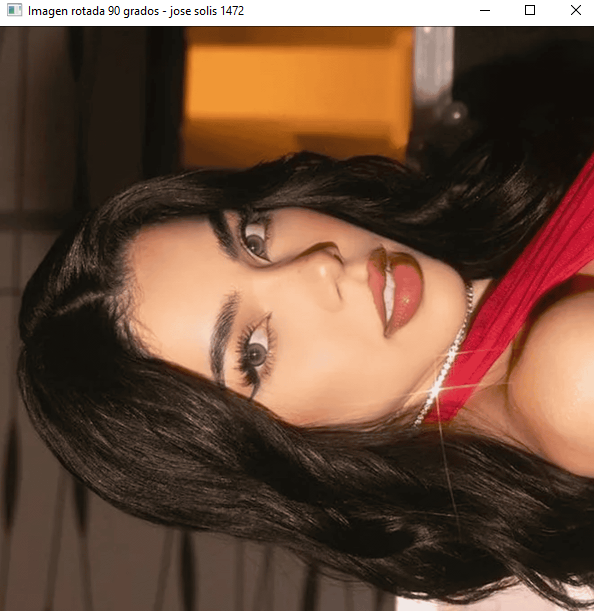
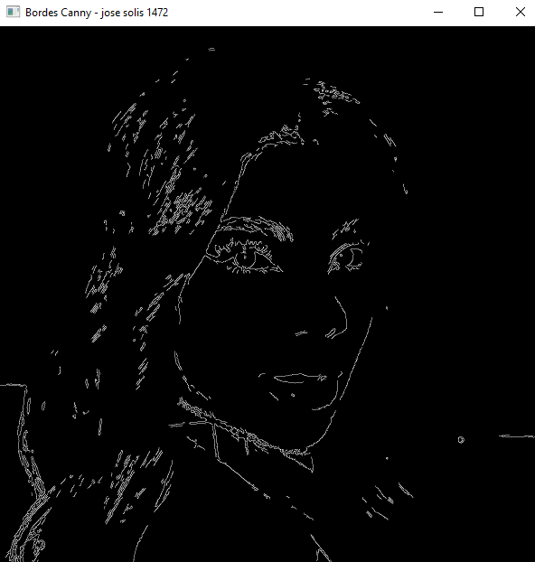
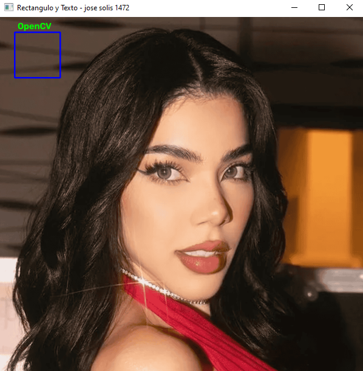
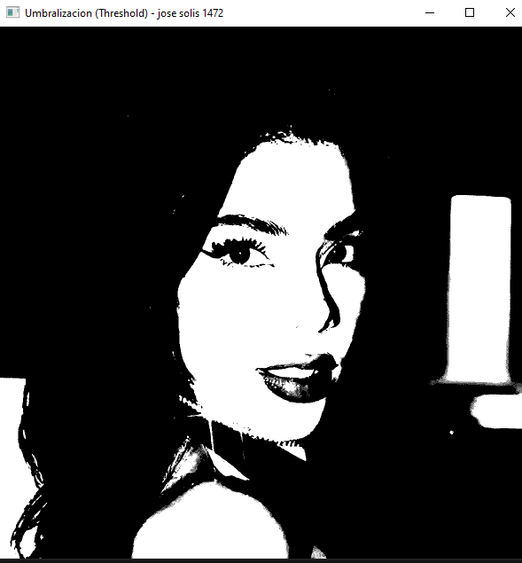
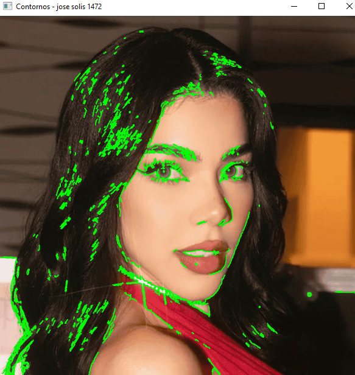

## imagen original

## imagen en gris

## imagen redimensionada

## imagen rotada

## imagen desenfocada

## bordes canny

## imagen con rectangulo

## imagen con umbrilizacion

## imagen con contornos
